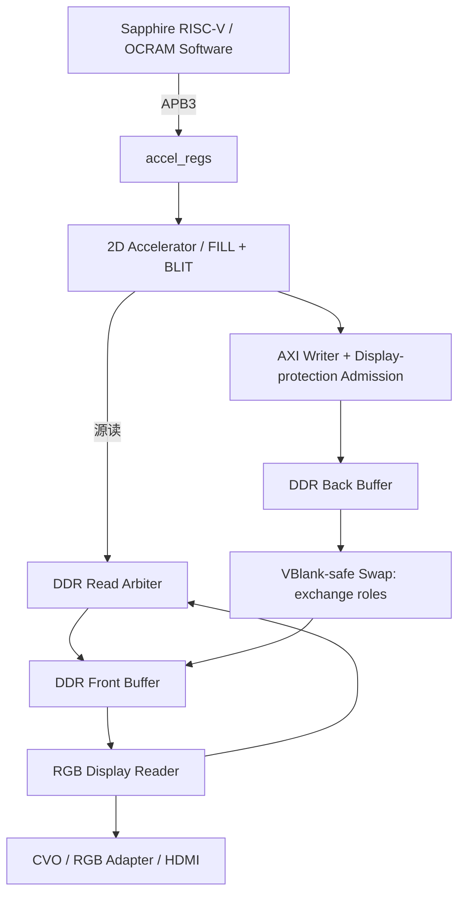

# Ti60F225 RISC-V + FPGA 2D Accelerator

基于 Efinix Ti60F225、Sapphire RISC-V 和 FPGA 2D Accelerator 的 DDR Framebuffer 图形渲染平台。

RISC-V 负责命令与控制，FPGA 执行像素写入，通过双缓冲和安全换帧持续输出 HDMI。

## 工程状态

| Checkpoint | 已完成能力 | 硬件状态 |
|---|---|---|
| A | XRGB8888 TPG → DDR → RGB Display Reader → HDMI | 通过 |
| B | Sapphire RISC-V、Hard JTAG、APB3 自定义寄存器 | 通过 |
| C | FILL_RECT Accelerator → DDR → HDMI，五参数可改变矩形 | 通过 |
| D | Front/Back、VBlank-safe Swap、连续显示保护 | 通过 |
| E | 多矩形双场景 Demo、持续循环、软件 API 与诊断 | 通过 |

正式源码现已接入 **FILL_RECT + Front→Back BLIT**：APB命令快照、统一执行层、源窗口检查、DDR读仲裁、显示统计及安全换帧。新增v4代码尚待Efinity综合/时序和实板验收；上表通过记录属于旧FILL基线。Line、Alpha Blend尚未实现，基础框架不代表赛题全部功能完成。接线、运行及边界见 [BLIT_INTEGRATION](docs/BLIT_INTEGRATION.md)。

[显示/BLIT DDR读仲裁器](docs/DDR_READ_ARBITER.md) 已加入正式framebuffer及工程清单，支持低水位显示优先、健康状态轮流服务、固定burst归属及协议故障保留。v4寄存器为VERSION=0x00040000、CAPABILITIES=0x7B；必须重新构建匹配软件，不能使用旧v3 ELF。

## 框架



CPU 不逐像素绘图，也没有直接连接 DDR framebuffer 的外部 AXI 端口。所有大规模像素写入由硬件 Accelerator 完成；交换只改变缓冲角色，不搬运整帧数据。模块和时钟细节见 [ARCHITECTURE](docs/ARCHITECTURE.md)。

## 关键设计要点

下表按当前顶层、RTL、正式生成的 BSP/配置及活动软件核对。

| 项目 | 当前实现 |
|---|---|
| FPGA / 工具 | Efinix Ti60F225；Efinity 2026.1；Efinix RISC-V IDE 2026.1 |
| CPU | 单核 Sapphire 3.4.0，100 MHz，RV32IM；Hard JTAG |
| 输出 | 1920 × 1080 @ 60 Hz |
| Pixel format | XRGB8888；每 pixel 4 bytes，X 被显示链忽略 |
| Bit layout | `[31:24] X`、`[23:16] R`、`[15:8] G`、`[7:0] B` |
| DDR byte 顺序 | 低地址到高地址为 B、G、R、X；软件颜色使用 `0x00RRGGBB` |
| Frame stride / size | 7680 bytes；8,294,400 bytes = `0x7E9000` |
| DDR AXI | 128-bit data、32-bit byte address；16 bytes/beat = 4 pixels/beat |
| Beat pixel order | `WDATA={P3,P2,P1,P0}`，P0 位于最低 32 位 |
| APB | APB3、32-bit 数据、4-byte 对齐整字，无 PSTRB；默认 1 wait cycle |
| CPU 软件位置 | 64 KiB OCRAM，`0xF9000000`；CPU 不直接访问 framebuffer |
| Accelerator / DDR AXI / core | 共用 `core_clk = 100 MHz` |
| Display / CVO | `vid_clk_dvi2 = 74.25 MHz`，每拍两个 pixels |
| HDMI pixel clock | `hdmi_tx_slow_clk = 148.5 MHz`，每拍一个 pixel |
| DDR physical | 原控制器/PHY，DDR clock 400 MHz，DQ16；配置容量 256 MiB |
| Buffers | Buffer0=`0x00000000`，Buffer1=`0x00800000`，每槽预留 8 MiB |
| Ownership | Display Reader 只读 Front；Accelerator 每命令锁存 Back 地址 |
| Swap | 软件显式请求，安全 VS/frame boundary、旧 R 完成与 FIFO 清空确认后交换 |
| DONE | 最后一个成功 AXI B response 后完成；软件还检查 BUSY=0、writer ownership 释放 |
| 当前源码命令 / 通知 | FILL_RECT、BLIT；polling，无 Accelerator interrupt；BLIT待板级验证 |
| 连续性保护 | 真实 R handshake quota + Display FIFO 低/高水位控制新写 burst 准入 |
| Camera / Bayer / Debayer | 不在正式 2D 数据路径；部分旧文件和 physical blocks 保留作参考/兼容 |

APB base 来自正式 BSP 宏，当前为 `0xF8100000`，不是从旧 Demo 猜测。全部 offset、reset 和 clear 语义见 [REGISTER_MAP](docs/REGISTER_MAP.md)。

## 为什么选择 XRGB8888

Bayer 适合摄像头原始采样，2D 图元需要明确的 R/G/B 颜色。Packed RGB888 的 3-byte pixel 会增加 128-bit beat 的像素跨界处理；XRGB8888 让一个 beat 正好容纳四个完整 pixels，简化地址和 FILL_RECT strobe，也便于后续 BLIT/混合单元处理。当前 X **不是 Alpha**，未来 Alpha 的输入格式与规则需另行定义。

## 缓冲与显示

- **Front**：Display Reader 持续读取，绘制 Back 期间保持旧画面。
- **Back**：Accelerator 可连续执行多条 FILL_RECT，构建完整场景。
- 软件最后发出 `SWAP_REQUEST`；系统保持 `SWAP_PENDING`，等待 writer 完成和安全边界。
- 完成旧帧全部 R 返回、流水线排空及安全 FIFO flush 后，原子交换 Front/Back，置 sticky `SWAP_DONE`。

**Swap 不复制图像。** 旧 Front 成为新 Back，不保证含最新场景；当前软件每轮完整清屏并重建。协议见 [INTERFACES](docs/INTERFACES.md)。

## 显示连续性保护

开发时实际遇到过：连续写 DDR → Reader 服务不足 → FIFO underflow → CVO 重启 H/V timing → HDMI 黑屏、missed boundary 增长，现已修复并上板通过。

正式保留 **Display-protection write admission**：Reader 活跃时，按真实 R handshake 进展及 FIFO 水位限制下一笔 Accelerator 写 burst；已暴露的 AW 保持到完成，不门控 W/B 或 AR/R。完整故障链和定位办法见 [TROUBLESHOOTING](docs/TROUBLESHOOTING.md)。

## 当前加速器指令

| 命令 | 参数 | 状态 / 语义 |
|---|---|---|
| **FILL_RECT：已实现、已上板** | `x, y, width, height, color` | START 接收时快照参数；BUSY 执行；成功 DONE 以最后 B 完成为准 |
| Block Copy / BLIT | `src_addr, src_stride, dst_x, dst_y, width, height` | 已接正式系统，RTL及CPU行为仿真通过；`DEMO_MODE=2`运行复制演示，综合/时序及实板待验收，见[SYSTEM_BLIT](docs/SYSTEM_BLIT.md) |
| Line | Planned / Not implemented | 可选图元扩展 |
| Alpha Blend | Planned / Not implemented | 后续混合管线 |

矩形不做裁剪；要求尺寸非零且完全位于有效画面内，非法几何返回错误。软件 API、错误处理和演示参数见 [BUILD](docs/BUILD.md)。

## 代码仓库结构

```text
rtl/             顶层、控制、Accelerator、Framebuffer、Display 与继承硬件模块
software/        当前 apb_reg_test Demo/API，以及旧阶段软件快照
sim/             APB、FILL_RECT、buffer manager、显示及并发压力测试
scripts/         构建、接口/来源校验和仿真入口
ip/              厂商生成 IP，默认只读
embedded_sw/     正式 Sapphire 生成 BSP、启动文件及支持文件，默认只读
constraints/     项目约束相关文件
README.md        快速介绍与文档导航
docs/            项目说明、独立模块与集成草案
demo/            原始参考工程，只读
docs_reference/  开发板资料和赛题指南，只读
```

正式 Efinity 工程位于根目录 `ti60f225_oob.xml`，顶层 `ti60f225_oob_top`。

## 分工

### Person A — RISC-V / Control / Software

负责 Sapphire/BSP 集成、APB driver、accel API、command submission、polling、软件 Demo 与软件验证。主要目录：`software/apb_reg_test/`、`rtl/control/`，以及对应构建/软件测试脚本；生成 BSP 不手改。

### Person B — 2D Accelerator

负责命令执行、FILL_RECT、地址生成、AXI writer、Accelerator 仿真，以及后续获准开发的 BLIT/Line/Alpha。主要目录：`rtl/accelerator/`，以及对应 `sim/` 测试。

### Person C — DDR / Framebuffer / Display

负责 DDR 集成、Display Reader、Front/Back、buffer_manager、VBlank Swap、HDMI、连续性保护及 DDR 服务诊断。主要目录：`rtl/framebuffer/`、`rtl/frame_buffer_V4/`、`rtl/display/`、`rtl/user_cvo_axi_v2/`；DDR/PHY/encoder 的生成或继承实现默认只读。

**冻结共享接口**：APB Register Map、Command interface、Pixel format、DDR 地址单位、AXI 数据宽度、Buffer ownership、Swap 和 DONE 语义。任何人修改前必须与另外两人同步。详细边界及联调规则见 [TEAM_SPLIT](docs/TEAM_SPLIT.md)。

## 开发规范

- `demo/`、`docs_reference/` 保留原始参考内容。
- 厂商生成 IP/BSP 不手改；DDR Controller 和已验证 HDMI 路径不随意重写。
- 新功能通过已冻结接口扩展，先明确共享契约的变化。
- 不移除写准入保护，不以屏蔽 underflow/missed 或强制 swap 掩盖故障。
- 修改共享接口先同步团队；功能完成后更新验证记录，区分仿真与实板结果。

## Build and Debug

```text
Efinity → Compile → Programmer → RISC-V IDE → Build → Hard JTAG Debug
```

当前基线无需重新 Generate IP。活动软件项目为 `software/apb_reg_test`，Debug launch 为 `apb_reg_test_ti`。完整操作、正确 BSP/OpenOCD 路径及 PC 设置见 [BUILD](docs/BUILD.md)。

## 文档

| 文档 | 用途 |
|---|---|
| [ARCHITECTURE](docs/ARCHITECTURE.md) | 当前模块、时钟/复位、DDR、双缓冲与显示保护 |
| [INTERFACES](docs/INTERFACES.md) | A↔B、B↔C、A↔C 的冻结接口合同 |
| [REGISTER_MAP](docs/REGISTER_MAP.md) | 按当前 RTL 核对的寄存器、reset、位域、错误与 clear |
| [BUILD](docs/BUILD.md) | Compile、下载、Build、Debug 与 Demo 操作 |
| [VALIDATION](docs/VALIDATION.md) | A～E 仿真/实板证据、吞吐边界与复验方法 |
| [TROUBLESHOOTING](docs/TROUBLESHOOTING.md) | 已遇到故障、根因、修复和验证 |
| [TEAM_SPLIT](docs/TEAM_SPLIT.md) | 三人责任、目录归属及共享接口变更规则 |
| [ROADMAP](docs/ROADMAP.md) | 按赛题实际要求安排的后续任务与验收出口 |
| [BLIT](docs/BLIT.md) | 独立复制原型、运行方法、接口草案和当前限制 |
| [GRAPHICS_ENGINE](docs/GRAPHICS_ENGINE.md) | FILL/BLIT统一入口、混合场景仿真与三步结果图 |
| [COLOR_KEY](docs/COLOR_KEY.md) | 色键独立模块及B统一入口可选命令、混合绘制与对比图；正式v4默认关闭，待系统接入 |
| [BLIT_INTEGRATION](docs/BLIT_INTEGRATION.md) | 按A/C反馈确定的首轮接口、实施状态与验收步骤 |
| [BLIT_SOURCE_GUARD](docs/BLIT_SOURCE_GUARD.md) | C侧源窗口检查、accept时序、边界用例及对接限制 |
| [DDR_READ_ARBITER](docs/DDR_READ_ARBITER.md) | 显示/BLIT读仲裁、响应归属、故障保留及独立测试 |

`docs/` 维护上述长期说明及 BLIT 原型交付文档。历史阶段性快照和验证摘要已合并清理；正式 testbench 与回归脚本保留在 sim/、scripts/。

## 路线图

- **优先**：Block Copy / BLIT；为 Accelerator 增加受显示保护的 DDR read 服务。
- 建立板级性能测量及赛题要求的纯软件/硬件渲染对比方案。
- Alpha Blend、Color Keying 与后续高负载互动 Demo。
- Line、进一步命令扩展，以及依据测量决定的 FIFO / line buffer / cache 优化。

BLIT 已接入正式v4系统并通过模块、共享DDR系统与软件行为仿真；Efinity资源/时序和实板验收仍待完成。性能对照、图片资源加载、Alpha/Color Key和互动Demo仍按 [ROADMAP](docs/ROADMAP.md) 规划。
