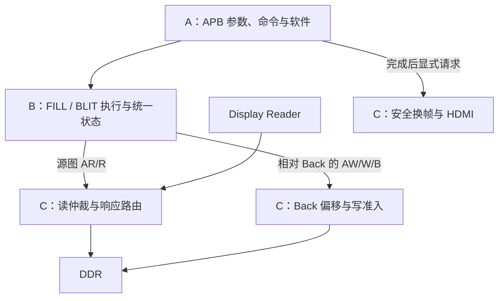

# BLIT 第一轮集成对接草案

日期：2026-10-17。对照版本：`cdb9159`，Person B 的独立 BLIT 原型。

状态：**供 A/B/C 讨论，尚未共同确认，尚未实现系统集成。** 本文提出建议，不重新分配现有寄存器或修改冻结接口。正式合同仍见 [INTERFACES](INTERFACES.md)、[REGISTER_MAP](REGISTER_MAP.md) 和 [TEAM_SPLIT](TEAM_SPLIT.md)。已完成的独立模块与验证见 [BLIT](BLIT.md)。

## 1. 下一轮的共同目标

由 RISC-V 提交一条 BLIT 命令，把 DDR 中已有的 32×32 彩色图块复制到 Back 指定位置。复制期间 Front 显示稳定；复制成功后，软件显式请求换帧，屏幕才呈现新位置的图块。现有 FILL_RECT 继续可用。

分工对应的数据流为：

这里的“接口”就是三人事先约定的一组参数和信号。A 决定复制什么，B 执行搬运，C 安排 DDR 服务并保证显示。大家可以各自开发，连接两侧必须采用同一份约定。

## 2. 当前代码已有和缺少的部分

| 范围 | 已有 | 本轮需要补齐 |
|---|---|---|
| A：控制/软件 | FILL 参数、START、状态轮询、显式 swap API | 操作类型、源地址/stride、新 BLIT API 与兼容处理 |
| B：执行单元 | FILL 已在系统中使用；BLIT 已独立仿真通过 | FILL/BLIT 选择、公共状态与计数、两种命令交替执行的测试 |
| C：内存/显示 | Display Reader 独占读端；Back 写准入与安全换帧 | BLIT 读服务、显示/BLIT 读仲裁、响应路由及并发验证 |
| 共同集成 | 正式顶层目前只接 FILL | 指定集成人同步接线、源清单、接口文档、系统测试及上板 |

## 3. A → B：命令参数建议

信号名表示建议含义，最终端口名由双方确认。现有 `cmd_x/y/width/height/color` 可继续使用。

| 字段 | 建议含义 | 第一轮规则 |
|---|---|---|
| `cmd_op` | 选择 FILL_RECT 或 BLIT | 建议 FILL 编码为 0、BLIT 为 1；待确认 |
| `cmd_x`、`cmd_y` | 目标左上角，单位像素 | 继续使用现有字段 |
| `cmd_width`、`cmd_height` | 矩形宽高，单位像素 | 非零、目标矩形不越界 |
| `cmd_color` | FILL 的 XRGB8888 颜色 | BLIT 不使用 |
| `cmd_src_addr` | 源首像素的 32 位绝对字节地址 | BLIT 使用，16 字节对齐 |
| `cmd_src_stride` | 源图相邻行首的字节距离 | BLIT 使用，16 字节对齐且至少 `width*4` |
| START / `command_accept` | 启动请求 / 平台最终接受 | 保留现有 START→manager→执行单元的路径 |

首次有效 APB START 对所有命令字段做一次快照；manager 最终接受时，B 锁存执行选择和参数，C 锁存 Back base。执行期间再写参数、CPU debug reset 或下一次软件调用，都不能改变已接受事务。

BLIT 第一轮维持原型限制：`x` 和 `width` 是 4 像素的倍数。FILL 继续保留原有任意像素 x/width 与边缘 WSTRB 能力，不能把 BLIT 限制套到旧 FILL 上。

### 寄存器和软件兼容

- 现有 offset `0x00..0xB8` 及语义保留。新增字段的 offset、访问/复位规则由 A 提出并共同确认，本草案不直接占用新地址。
- 建议操作类型复位为 FILL；更新后的 `accel_fill_rect()` 每次显式选择 FILL，避免执行 BLIT 后下一次填充仍被解释成 BLIT。
- 建议增加 `accel_blit(src_addr, src_stride, x, y, width, height)`，返回约定与 FILL 一样：提交确认和执行成功分别检查。
- 当前 `accel_init()` 对 VERSION 和 CAPABILITIES 做精确匹配。A 扩展能力标志时必须同步软件期望值、检查脚本和兼容策略；不能只改硬件常量。
- opcode 数值、非法 opcode 的拒绝/计数规则、BLIT 错误码映射及软件调用名仍需 A/B 确认。

## 4. B → A/C：执行选择和状态

建议由 B 增加一个公共执行层，内部选择现有 `fill_rect_writer` 或 `blit_engine`；一次只启动一个执行单元，按命令锁存选择。

| 公共输出 | 建议规则 |
|---|---|
| `busy` | 覆盖整条 FILL/BLIT，包括 BLIT 只读阶段、写阶段和出错排空 |
| `done` | 当前命令结束的 sticky 状态；接受下一命令时清旧值 |
| `error_code` | 当前命令结果；0 才表示成功，最终编码待确认 |
| `command_count` | 每次公共命令被接受只加一次，参数非法命令保留现有计数语义 |

不能直接 OR 两个单元的 sticky DONE/ERROR：空闲单元可能还保留上一次结果。公共计数也不能在切换单元时改成其中一个单元的局部计数。

manager 的 `writer_busy/writer_done/writer_error` 应接公共结果；从 BLIT 接受命令开始就持有 Back，直到所有读写事务处理结束。最后成功 B 返回之前不得报告成功。错误或 FAULT 期间按现有安全规则阻止失败画面被发布。

## 5. B ↔ C：DDR 读写服务建议

### 地址与数据

| 项目 | 本轮建议 |
|---|---|
| 时钟/复位 | core 100 MHz / 平台复位，沿用当前域；CPU reset 不取消 DMA |
| 像素 | XRGB8888，低地址 B/G/R/X；128 位数据每拍四像素，低32位是 P0 |
| B 的读地址 | 绝对字节地址，C 不再加 Front/Back base |
| B 的写地址 | 相对 Back 的字节地址，C 加一次锁存的 `command_base` |
| burst | BLIT 最多32beats、INCR、16bytes/beat，读写分别不跨4KiB |
| sideband | 沿用 ID0、SIZE4、CACHE3、PROT2、LOCK0、QOS0；C 补齐常量 |
| 读信号 | ARADDR32/ARLEN8/ARVALID/ARREADY；RDATA128/RID4/RRESP2/RLAST/RVALID/RREADY |
| 写信号 | AWADDR32/AWLEN8/AWVALID/AWREADY；WDATA128/WSTRB16/WLAST/WVALID/WREADY；BID4/BRESP2/BVALID/BREADY |

### 读仲裁和返回数据归属

建议第一轮采用整个 DDR 读通路最多一笔 outstanding 的方案。Display Reader 和 BLIT 共用 ID0，由 C 记录这笔事务属于谁，再把返回的 R 只交给对应一方。Display Reader 的现有 burst 可达128beats，不能因为 BLIT 最多32beats而一并缩短或错误拒绝显示请求。

1. AR 一旦对 DDR 暴露，选择和载荷保持到握手，不因优先级变化撤回 VALID。
2. AR 被接受后锁存 owner；对应 R burst 完整结束前，不切换到另一方的读事务。正常末拍必须同时满足预期计数和 RLAST。
3. 未选中的 master 不获得 ARREADY；RVALID/RDATA/RRESP/RID/RLAST 和 RREADY 按 owner 路由，不能广播读数据。
4. 显示低水位时优先补显示，但也要在健康水位下给 BLIT 可验证的服务机会。仲裁等待上限应与 B 的 watchdog 一起确认，不能让 BLIT 永久等待。
5. 不把整条 BLIT 的执行期锁成“DDR 全归 BLIT”。两段 BLIT 事务之间必须允许 Display Reader 继续读。

### 需要 C 特别检查的现有接线

当前 `rgb_framebuffer.v` 的 `read_frame_guard` 和 `ddr_write_admission` 直接观察公共 AR/R；目前只有 Display Reader，所以成立。增加读仲裁后，需要改为观察**属于 Display Reader 的握手/响应**：

- BLIT 返回数据不能计入显示的518400beats/frame，也不能进入显示 FIFO。
- BLIT 的 R 握手不能充当“显示已经获得服务”的 read quota。
- 显示 reader 的 outstanding、错误、帧完成及等待诊断继续按显示事务计算。
- Display FIFO 的正常 frame flush 不得清除 BLIT 的缓存、owner 或在途事务。

### 写准入和错误

FILL/BLIT 共用现有受显示保护的 Back 写服务。每笔 AW 准入一旦向 DDR 暴露，应一直保持到完成；W/B 不额外等待下一笔显示额度。B 的源图读不应依赖“先拿到写准入”，以免互相等待。

当前原型对 RRESP/RID 错误排空已接受读 burst，坏数据段不写出；BRESP/BID 错误后停止后续段；超时保持已提出的 VALID，等待事务排空。早到或缺失 RLAST 会进入 FAULT，保持 BUSY 并等待平台复位。C 需共同确认协议故障下的路由保留与平台恢复方式，不能用 CPU reset 假装撤销事务。

## 6. 第一轮源图建议：从 Front 复制到 Back

当前 Sapphire CPU 没有直接 DDR 访问端口，C 数组不能自动成为 DDR 源图。第一轮建议利用已有 FILL 和换帧，先在 Front 建立源图，再复制到另一个 Back，无需先新增图片文件上传通路。

这项建议需 A/C 同意：它增加 BLIT 对 Front 的只读访问，仍保留显示读 Front、绘图只写锁存 Back 的规则。

最小 Demo 顺序：

1. A 用已有 FILL 清空 Back，在 `(0,0)` 的32×32区域画四块16×16的不同颜色；每条命令都等待成功。
2. A 请求并确认 swap，彩色源图成为当前 Front 的内容。
3. A 用 FILL 清空新的 Back；当前 Front 继续显示源图，保持不变。
4. 无 pending swap、无在途命令时，A 读取 Front base，提交 `src_addr=Front base`、`src_stride=7680`、`x=64`、`y=64`、`width=32`、`height=32` 的 BLIT。
5. B/C 完成复制，软件等待命令计数确认及 `done=1 && busy=0 && error=0`，并确认 writer ownership 释放。
6. A 显式请求并确认下一次 swap；屏幕应在 `(64,64)` 显示完全相同的四色图块。

单 CPU 命令流中，从获取源 Front 到 BLIT 完成不能插入 swap。系统接收层也需确认并约束源图位于锁存 Front 的有效帧范围内，源坐标/宽高合法、源 stride 等于帧 stride、源目标不重叠；由 A/C 约定校验责任和失败报告。不能仅凭一个软件地址值就允许读取任意 DDR 区域。

这只是第一轮联调的源图办法。PNG/BMP、串口或其他资源加载方式在此后另行设计，正式图片资源区地址尚未分配。

## 7. 各自可以继续做什么

| 人员 | 当前可以准备 | 依赖共同确认后实施 |
|---|---|---|
| A | 梳理现有 API/寄存器扩展，准备上述 Demo 的软件调用流程 | 新 offset、opcode、版本/能力、BLIT API 和正式命令输出 |
| B（你） | 复现 BLIT 测试，整理端口与限制，设计公共执行层和混合命令测试 | 按确认的命令格式实现选择层、统一状态及错误映射 |
| C | 确认读仲裁插入点、显示服务统计/flush 影响，准备仲裁测试方案 | 读服务、响应路由、Back ownership、显示保护与共享接线 |

共享顶层 `rtl/ti60f225_oob_top.v`、`rgb_framebuffer.v` 的跨边界连接以及 Efinity 工程清单，建议指定 C 或共同指定的集成人统一修改；B 提供执行层实例端口，A 提供命令/状态端口。

## 8. 开始写集成代码前的确认表

| 需要确定的内容 | 建议答案 / 待补项 | 确认人 |
|---|---|---|
| 第一轮目标 | 32×32 Front→Back，FILL保留，显式swap显示 | A/B/C |
| 命令字段与编码 | 本文第3节；FILL=0、BLIT=1仅为建议 | A/B |
| 新寄存器、版本与能力 | A给出分配及复位值，保持旧offset | A/B/C |
| 地址与源图范围 | 绝对源地址、相对Back写地址；首轮仅有效Front范围 | A/B/C |
| 读服务与等待界限 | 一笔全局outstanding、burst级owner、显示优先且BLIT有进展；等待上限待C验证 | B/C |
| 完成、错误及恢复 | 公共BUSY/DONE/count；映射错误码；FAULT保持与平台恢复 | A/B/C |
| 接线、合并和板级执行人 | 待填姓名；合并前保留各模块测试与旧基线回归 | A/B/C |

## 9. 验收顺序

1. **B 执行层单测**：FILL→BLIT→FILL、参数快照、旧sticky DONE不干扰、公共计数、非法命令、背压/错误及超时排空。
2. **C 读仲裁单测**：显示与BLIT同时请求、AR/R停顿稳定、owner不串、正常/错误响应路由、帧flush、显示优先和BLIT最终进展。
3. **系统仿真**：APB启动→复制→软件确认→swap；同屏显示与BLIT并发，Front构建期不变，underflow/missed增量为0，旧FILL与换帧回归通过。
4. **Efinity 检查**：指定集成人加入源清单、综合、布局布线，保存资源与时序结果。工具版本先与 A 已成功的 Efinity 2026.1 构建和许可一致。
5. **实板联合验收**：按第6节完成四色图块复制，记录版本、诊断baseline/delta、连续运行结果。仿真通过不替代实板签收。

到第5步需要团队板卡，前面的端口讨论、单测和工程准备可以各自进行。未新增实现前，本草案不宣称上述验收已通过。
