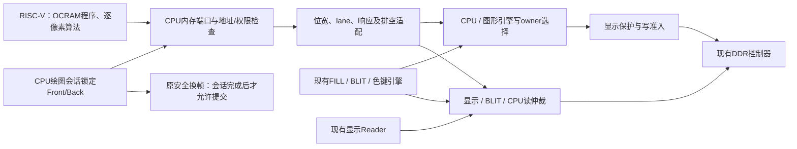

# CPU 软件渲染对照接入方案

2026-10-20 源码核对。本文是实施方案，尚未新增 CPU DDR 接口、寄存器或软件测试模式，也没有重新生成 Sapphire IP。现有 v5 实板数值见 [V5_BOARD_BENCHMARK](V5_BOARD_BENCHMARK.md)。

## 目标

让同一颗 RISC-V 逐像素执行 FILL、普通复制和色键复制，并与 FPGA 命令在相同显示条件、几何、图案和计时范围下比较。软件色键比较必须由 CPU 完成，不能让 CPU 调用现有 BLIT/FILL 硬件后将其称作软件渲染。

先实现小矩形的正确读写与画面，再逐步扩大到现有四种尺寸。性能对比需在同一个新 bit 下重新运行双方，不将本次旧 v5 基线当作新互连的硬件成绩。

## 当前连接已经确认的事实

| 依据 | 源码事实 | 对后续实现的影响 |
|---|---|---|
| [sapphire_control.v](../rtl/control/sapphire_control.v) 与 [soc_control.v](../ip/soc_control/soc_control.v) 的公开端口 | CPU 只导出 APB0，没有外部 AXI/DDR master | 直接写 `*(volatile uint32_t *)DDR地址` 不会获得 framebuffer 访问能力 |
| [settings.json](../ip/soc_control/settings.json) | DDR=0、DDR_AXI4=0、Cache=0、OCRSize=65536；同时存在 AXIMaster=1 旧字段 | 不根据单个配置键推断已存在接口；生成后的公开端口才是接线依据 |
| [soc.h](../embedded_sw/soc_control/bsp/efinix/EfxSapphireSoc/include/soc.h) | OCRAM 64 KiB，APB0 64 KiB，CLINT 100 MHz；没有外部 framebuffer 映射宏 | 全屏 8,294,400 bytes 无法放进 OCRAM；新 CPU 地址必须以重新生成的映射为准 |
| [rgb_framebuffer.v](../rtl/framebuffer/rgb_framebuffer.v) | 初始化后写通道由加速器独占，读端仲裁仅含显示和 BLIT | 需要增加 CPU 访问路由与 owner，不能把 CPU VALID 与现有通道直接 OR |
| [buffer_manager.v](../rtl/framebuffer/buffer_manager.v) | WRITER_OWNED 当前由加速器接收/完成驱动，swap 检查 engine_busy | CPU 绘图期间也必须锁定 Back，避免未完成写入就被显示 |
| [ddr_write_admission.v](../rtl/framebuffer/ddr_write_admission.v) | 每笔 B 结束后重新积累 128 个显示 R 握手；不按 AWLEN 调整额度 | 单像素短事务的节流开销可能很大，需要单独分析和披露 |

## 路径选择

| 路径 | 工作与条件 | 对照结果的含义 |
|---|---|---|
| 优先评估：通过 Sapphire IP Manager 导出 CPU 内存 master | 确认 IP 支持的实际端口，生成配套 BSP，再做地址映射、总线适配和仲裁 | 可作为同板 CPU 通过内存总线逐像素渲染的主要对照；仍需说明缓存、适配器和显示保护条件 |
| 备选：在现有 APB 范围内增加像素访问窗口 | 不改变 CPU 生成配置，但要新增桥、读写路由、ownership 和错误状态 | 可运行真实 CPU 软件算法、加载图像、检查 DDR 像素；成绩必须注明受 APB 传输和桥接限制 |
| 仅在 OCRAM 中跑像素循环 | 容量只够小区域，而且没有完成同一显示目标的读写 | 可验证算法或测局部 CPU 内核，不替代同 DDR framebuffer 的完整对照 |

建议先核实第一条路的生成能力，再确定正式对照接口。APB 方案可作为有明确用途的备选，不能因为加速比更大就优先采用。IP Manager 的选项名称、导出总线类型、位宽、ID 和地址尚未通过重新生成确认，本文不编造可直接连接的端口名。

## 推荐内存 master 路径的接入结构

实现边界：

1. 用 IP Manager 生成带外部内存访问能力的 Sapphire 配置；保持 OCRAM 执行程序、100 MHz、Hard JTAG 和首轮 Cache 关闭。保留原配置作基线，生成对应 BSP，检查新的内存图和链接脚本，不手改厂商生成 RTL 来添加端口。
2. CPU 内存地址先转换为 DDR byte 地址，再检查访问权限。具体基址在生成后确定，不把当前 DDR 物理地址 0 当作已有 CPU 地址。首轮限自然对齐 32-bit 像素访问，只允许锁存 Front 的源读和锁存 Back 的目标读写，拒绝 Front 写和帧尾 padding。
3. 开始 CPU 绘图会话时，要求初始化及读服务正常、无 accelerator busy/owned、无 pending swap；同拍锁存 Front/Back 并取得写 owner。会话期间禁止启动加速器及提交角色交换。允许两种渲染方式顺序对比，不要求同时绘图。
4. 会话结束必须有显式 fence/flush/drain 确认：所有缓冲数据送出、最后成功 B 已收齐、CPU 源读返回完毕后才释放 owner。CPU 端一次 store 返回不一定代表 DDR 写入完成。CPU 调试复位不得撤销已经暴露的 AXI VALID、释放在途 owner 或清掉错误；恢复路径要在新版本明确。
5. DDR 端保持 128-bit 完整 beat。若 CPU 导出 32-bit 访问，写地址按 16-byte 对齐，按地址低位放置像素并使用对应四位 WSTRB；读回后选择对应 32-bit lane。实际若是其他位宽或 AXI shared 接口，则按真实端口增加拆分/适配，不能直接假接到现有 AW/AR。
6. 读仲裁需增加 CPU 客户端，或在 accelerator 完全空闲且无在途事务时复用原非显示客户端。任一方案都要锁定每笔 burst 的响应 owner，显示低水位优先，CPU 读不能计入显示 guard/写准入的读额度；所有通道保持反压稳定、4 KiB 边界和响应错误检查。
7. 写路由在原初始化屏障之后选择 CPU 或 accelerator，经共同的显示保护才到 DDR。当前 writer 统计必须明确覆盖哪个 owner；新增 CPU 会话、错误和排空状态要定义版本/能力识别，不假称它们已经属于 v5 寄存器合同。

## 公平比较需要先解决的细节

当前每次准入最多支持 32-beat 写，但无论事务长短都消耗一次读额度。将 CPU 每像素写转换为一笔 128-bit、单 lane 有效的短事务，会增加事务数量及节流开销。因此即使使用原生内存端口，端到端差距仍包含 CPU 指令、总线适配、burst 效率和保护等待，不能全部解释成算法计算的加速。

首轮保留现有显示保护，记录两侧实际 burst 长度、有效字节、等待与完成时间。是否增加仅合并相邻 CPU store 的通用写缓冲，应在接口确认后明确：它只能搬运 CPU 已计算的像素，不能自己生成填充/复制/色键结果；fence、会话结束、地址不连续时必须排空。如果调整按写量计费的准入策略，需要在新 bit 对双方统一应用并重新验证显示连续性，不能只放宽 CPU 或 accelerator 的一侧。

首轮使用 Cache 关闭的生成配置避免一致性歧义。后续开启 Cache 时，要单独记录策略并落实 framebuffer 的 uncached 映射或 clean/invalidate，不能把尚未写回 DDR 的数据当作渲染完成。

软件与硬件统一：相同源图、目标背景、XRGB、几何、色键精确比较、预热和样本数；绘制包含必要提交、fence 与完成等待，准备和显示 swap 单独计时。色键源读和判断由 CPU 执行，透明像素保留 Back。最终再加相同场景、包含呈现等待的帧耗时/FPS 对照；硬件保持轮询时不宣称 CPU 已被释放。

## 可以逐步验收的小目标

| 阶段 | 交付 | 验收出口 |
|---|---|---|
| 1：生成能力确认 | 带外部 CPU 内存端口的候选配置、公开端口表、BSP 映射与恢复说明 | 单独生成成功；与原 APB/OCRAM/JTAG 设置逐项核对，才能冻结适配接口 |
| 2：总线与会话模块 | 地址/lane适配、owner/排空、读写路由及状态 | 仿真覆盖四个lane、边界、拒绝、读写反压、B/R错误、会话期间swap与CPU reset；无响应串线/提前释放 |
| 3：小矩形实板 | CPU 填充、CPU 源读及普通/色键复制，先64×64 | DDR读回与参考像素一致；Front保持，swap后画面一致，显示诊断增量0 |
| 4：完整对照 | 四尺寸×三操作的软件与硬件结果、同一bit重测 | 每组结果正确、8样本×3轮；记录版本/时钟/缓存/准入、耗时、像素吞吐、呈现帧时间与加速比 |

未完成阶段 1 前，后续模块的 CPU 侧端口只能作为候选，不能直接接进正式顶层。当前可复用已有 v5 benchmark 的计时和健康检查思路，但旧结构与版本检查需在实现新模式时配套更新。
