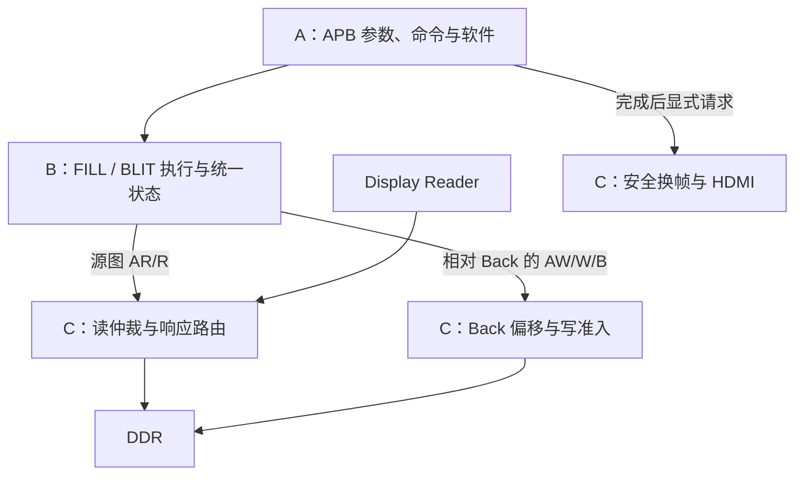

# BLIT 第一轮集成方案（2026-10-17历史记录）

**2026-10-18更新：以下为实施前约定与当时进度，当前接线、软件兼容、运行方法和剩余验收以 [正式系统BLIT接线](SYSTEM_BLIT.md) 为准。** APB、源检查器、共享读仲裁及B执行层现已接入正式源码；v4尚无综合时序/实板验收。

日期：2026-10-17。对照版本：`cdb9159`，Person B 的独立 BLIT 原型。

状态：**已按2026-10-17用户转来的A/C反馈记录本轮方案；B执行层已适配，系统集成尚未完成。** 以下区分下一轮约定与已实现状态，不表示新增CSR、读仲裁或实板功能已生效。当前正式工程的合同仍见 [INTERFACES](INTERFACES.md)、[REGISTER_MAP](REGISTER_MAP.md) 和 [TEAM_SPLIT](TEAM_SPLIT.md)。独立模块与验证见 [BLIT](BLIT.md)。

进度补充（2026-10-17）：B 的 [FILL/BLIT统一执行入口](GRAPHICS_ENGINE.md) 已支持0x26、C提供的src_range_valid、最终accept接收，85个像素/状态用例及7个真实manager合同用例通过。另新增默认/单拍两组双缓冲闭环，各20条命令、8次换帧，验证FILL构图后交替Front/Back复制及最后B前不得发布。正式APB、C源窗口检查器/DDR读仲裁、顶层和实板尚未接通；这些测试均不包含真实显示仲裁。

后续进度：已实现 [源窗口检查器](BLIT_SOURCE_GUARD.md)，1080p/7680与缩小画布两组各426个源矩形通过；manager合同扩展至17场景，合同和双缓冲均改用真实检查器。[显示/BLIT读仲裁器](DDR_READ_ARBITER.md) 也已实现并通过独立协议仿真；这两个C侧模块尚未接正式平台，当前没有整机/实板BLIT验收。

## 1. 下一轮的共同目标

由 RISC-V 提交一条 BLIT 命令，把 DDR 中已有的 32×32 彩色图块复制到 Back 指定位置。复制期间 Front 显示稳定；复制成功后，软件显式请求换帧，屏幕才呈现新位置的图块。现有 FILL_RECT 继续可用。

分工对应的数据流为：

这里的“接口”就是三人事先约定的一组参数和信号。A 决定复制什么，B 执行搬运，C 安排 DDR 服务并保证显示。大家可以各自开发，连接两侧必须采用同一份约定。

## 2. 当前代码已有和缺少的部分

| 范围 | 已有 | 本轮需要补齐 |
|---|---|---|
| A：控制/软件 | FILL 参数、START、状态轮询、显式 swap API | 操作类型、源地址/stride、新 BLIT API 与兼容处理 |
| B：执行单元 | FILL 已在系统中使用；BLIT、公共入口及本轮A/C接口适配已仿真通过 | 将本轮端口接入正式平台并参与系统回归 |
| C：内存/显示 | 正式Display Reader独占读端；Back写准入/安全换帧；源检查器及独立读仲裁仿真通过 | 正式接入检查器/仲裁器，适配显示统计/写准入并验证并发 |
| 共同集成 | 正式顶层目前只接 FILL | 指定集成人同步接线、源清单、接口文档、系统测试及上板 |

## 3. A → B：本轮命令约定

B公开端口使用团队约定的 `op/x/y/width/height/color/src_addr/src_stride/start/accept`，新增C到B的 `src_range_valid`。A/C上层网络仍可命名为 `cmd_*`，通过实例端口映射连接。

| 字段 | 建议含义 | 第一轮规则 |
|---|---|---|
| `op` | 选择 FILL_RECT 或 BLIT | FILL=0，BLIT=1；其他值接受后报0x26 |
| `x`、`y` | 目标左上角，单位像素 | 继续使用现有矩形寄存器 |
| `width`、`height` | 矩形宽高，单位像素 | 非零、目标矩形不越界 |
| `color` | FILL 的 XRGB8888 颜色 | BLIT 不使用 |
| `src_addr` | 源首像素的 32 位绝对字节地址 | BLIT 使用，16 字节对齐 |
| `src_stride` | 源图相邻行首的字节距离 | B保留通用对齐/至少width*4检查；首轮C强制7680 |
| `start` / `accept` | B的最终启动输入 / 实际接受输出 | B.start接manager.command_accept，accept仅作接收观察，不另触发或回接形成组合环 |
| `src_range_valid` | C锁存的源范围/stride检查结果 | 0也接收计数，随后报0x21且不发AR/AW |

首次有效 APB START 对所有命令字段做一次快照；manager 最终接受时，B锁存执行选择和参数，C锁存Back base及源范围结果。C在accept边沿更新的寄存结果，B在下一拍CHECK_SOURCE读取，避免同拍误读上一命令的结果。C需在这一采样沿前稳定结果；B检查通过前不启动BLIT、不暴露AR/AW。执行期间再写参数、CPU debug reset 或下一次软件调用，都不能改变已接受事务。详细时序见 [GRAPHICS_ENGINE](GRAPHICS_ENGINE.md)。

BLIT 第一轮维持原型限制：`x` 和 `width` 是 4 像素的倍数。FILL 继续保留原有任意像素 x/width 与边缘 WSTRB 能力，不能把 BLIT 限制套到旧 FILL 上。

### 寄存器和软件兼容

- 旧offset `0x00..0xB8`、访问和既有命令语义保留；正式启用BLIT时仅更新VERSION/CAPABILITIES等能力标识。约定新增 `0xBC COMMAND_OP`、`0xC0 SRC_ADDR`、`0xC4 SRC_STRIDE`，均32位RW、CPU/APB复位为0，成功START时与矩形字段一同快照；由A实施，当前仍未映射。
- `COMMAND_OP`复位为FILL；更新后的 `accel_fill_rect()` 每次显式写0，避免上一条BLIT残留类型影响填充。
- 增加 `accel_blit(src_addr, src_stride, x, y, width, height)`，返回0只确认COMMAND_COUNT增加；执行成功还需 `accel_wait_done()` 检查ERROR=0、DONE=1、BUSY=0、WRITER_OWNED=0，随后软件显式swap。
- 正式启用BLIT时目标 `VERSION=0x00040000`、`CAPABILITIES=0x0000007B`（新增bit6）；当前仍是0x00030000/0x3B。`accel_init()`精确匹配值、头文件、脚本、正式合同须随A/C系统实现同步更新，不能仅靠B独立仿真提前宣告能力。
- 非法opcode作为已接受的参数错误：公共计数加1、DONE=1、BUSY=0、ERROR_CODE=0x26，无AR/AW；Back按结束释放。下条真正接受的命令或平台复位清除，普通参数写、CPU/debug reset及CONTROL.bit1不清除执行层错误。

## 4. B → A/C：执行选择和状态

B的公共执行层已实现，内部选择现有 `fill_rect_writer` 或 `blit_engine`；一次只启动一个执行单元，按命令锁存选择。

| 公共输出 | 本轮规则 |
|---|---|
| `busy` | 覆盖整条 FILL/BLIT，包括 BLIT 只读阶段、写阶段和出错排空 |
| `done` | 当前命令结束的 sticky 状态；接受下一命令时清旧值 |
| `error_code` | 当前命令结果；0才表示成功，FILL0x11～0x13、BLIT0x21～0x25、非法opcode0x26 |
| `command_count` | 每次公共命令被接受只加一次，参数非法命令保留现有计数语义 |

不能直接 OR 两个单元的 sticky DONE/ERROR：空闲单元可能还保留上一次结果。公共计数也不能在切换单元时改成其中一个单元的局部计数。

manager 的 `writer_busy/writer_done/writer_error` 应接公共结果；从 BLIT 接受命令开始就持有 Back，直到所有读写事务处理结束。最后成功 B 返回之前不得报告成功。错误或 FAULT 期间按现有安全规则阻止失败画面被发布。

## 5. B ↔ C：DDR 读写服务约定

### 地址与数据

| 项目 | 本轮约定 |
|---|---|
| 时钟/复位 | core 100 MHz / 平台复位，沿用当前域；CPU reset 不取消 DMA |
| 像素 | XRGB8888，低地址 B/G/R/X；128 位数据每拍四像素，低32位是 P0 |
| B 的读地址 | 绝对字节地址，C 不再加 Front/Back base |
| B 的写地址 | 相对 Back 的字节地址，C 加一次锁存的 `command_base` |
| burst | BLIT 最多32beats、INCR、16bytes/beat，读写分别不跨4KiB |
| sideband | 沿用 ID0、SIZE4、CACHE3、PROT2、LOCK0、QOS0；C 补齐常量 |
| 读信号 | ARADDR32/ARLEN8/ARVALID/ARREADY；RDATA128/RID4/RRESP2/RLAST/RVALID/RREADY |
| 写信号 | AWADDR32/AWLEN8/AWVALID/AWREADY；WDATA128/WSTRB16/WLAST/WVALID/WREADY；BID4/BRESP2/BVALID/BREADY |

### 读仲裁和返回数据归属

按C回复，第一轮采用整个DDR读通路最多一笔outstanding。Display Reader和BLIT共用ID0，由C记录事务owner，再将R只交给对应一方。Display Reader现有burst可达128beats，不能因为BLIT最多32beats而一并缩短或错误拒绝显示请求。当前独立 `ddr_read_arbiter` 已实现并通过单测，正式reader/B/DDR通路仍待连接；端口、健康条件下的轮流服务和故障规则见 [DDR_READ_ARBITER](DDR_READ_ARBITER.md)。

1. AR 一旦对 DDR 暴露，选择和载荷保持到握手，不因优先级变化撤回 VALID。
2. AR被接受后锁存owner；对应R burst完整结束前不切换。正常释放必须同时满足RVALID、RREADY、RLAST以及接收拍数等于ARLEN+1。异常RLAST进入故障保留原owner，故障判定优先于正常释放。
3. 未选中的 master 不获得 ARREADY；RVALID/RDATA/RRESP/RID/RLAST 和 RREADY 按 owner 路由，不能广播读数据。
4. 显示低水位时优先补显示，但也要在健康水位下给 BLIT 可验证的服务机会。仲裁等待上限应与 B 的 watchdog 一起确认，不能让 BLIT 永久等待。
5. 不把整条 BLIT 的执行期锁成“DDR 全归 BLIT”。两段 BLIT 事务之间必须允许 Display Reader 继续读。

### 需要 C 特别检查的现有接线

当前 `rgb_framebuffer.v` 的 `read_frame_guard` 和 `ddr_write_admission` 直接观察公共 AR/R；目前只有 Display Reader，所以成立。增加读仲裁后，需要改为观察**属于 Display Reader 的握手/响应**：

- BLIT 返回数据不能计入显示的518400beats/frame，也不能进入显示 FIFO。
- BLIT 的 R 握手不能充当“显示已经获得服务”的 read quota。
- 显示 reader 的 outstanding、错误、帧完成及等待诊断继续按显示事务计算。
- Display FIFO 的正常 frame flush 不得清除 BLIT 的缓存、owner 或在途事务。

### 写准入和错误

FILL/BLIT 共用现有受显示保护的 Back 写服务。每笔 AW 准入一旦向 DDR 暴露，应一直保持到完成；W/B 不额外等待下一笔显示额度。B 的源图读不应依赖“先拿到写准入”，以免互相等待。

当前B对RRESP/RID错误排空已接受burst，坏数据段不写出；BRESP/BID错误后停止后续段；超时保持已提出的VALID，等待排空。早到/缺失RLAST进入0x25 FAULT，保持BUSY及Back ownership，禁止新命令和swap提交。C保留出错读burst的原owner，不把后续响应转交显示；内部故障时也不清除仍未完成的事务归属，无在途读时不凭空创建owner。统一平台复位负责清除相关在途事务，CPU/debug reset不可用于取消DMA；共享读故障后不承诺HDMI仍能正常供数。

本轮错误码：0x21包括源窗口/stride/尺寸/对齐错误，不发AR/AW；0x22为RRESP/RID；0x23为BRESP/BID；0x24为无进展超时且不撤回VALID；0x25为协议FAULT；0x26为非法opcode。0x21～0x24也可能伴随DONE，0x25保持BUSY；软件必须检查错误。B默认watchdog27位，在100MHz下约1.34秒无握手超时，C的实际最大等待仍待验证。

## 6. 第一轮源图建议：从 Front 复制到 Back

当前 Sapphire CPU 没有直接 DDR 访问端口，C 数组不能自动成为 DDR 源图。第一轮建议利用已有 FILL 和换帧，先在 Front 建立源图，再复制到另一个 Back，无需先新增图片文件上传通路。

本轮已按A/C反馈采用Front到Back方案：BLIT对Front只读，保留显示读Front、绘图只写锁存Back的规则。

最小 Demo 顺序：

1. A 用已有 FILL 清空 Back，在 `(0,0)` 的32×32区域画四块16×16的不同颜色；每条命令都等待成功。
2. A 请求并确认 swap，彩色源图成为当前 Front 的内容。
3. A 用 FILL 清空新的 Back；当前 Front 继续显示源图，保持不变。
4. 无 pending swap、无在途命令时，A 读取 Front base，提交 `src_addr=Front base`、`src_stride=7680`、`x=64`、`y=64`、`width=32`、`height=32` 的 BLIT。
5. B/C 完成复制，软件等待命令计数确认及 `done=1 && busy=0 && error=0`，并确认 writer ownership 释放。
6. A 显式请求并确认下一次 swap；屏幕应在 `(64,64)` 显示完全相同的四色图块。

单CPU命令流中，从获取源Front到BLIT完成不能插入swap。C接收层按最终accept的参数和Front锁存检查结果：src_stride=7680、src_addr>=Front base、像素对齐，扩展位宽计算offset=src_addr-Front base；推导src_x=(offset%7680)/4、src_y=offset/7680，宽高非零、src_x+width<=1920、src_y+height<=1080，并限制于有效0x7E9000字节。不能将整个8MiB槽视为有效图像，也不能允许源矩形横向跨行。Front与锁存Back必须不同。失败以src_range_valid=0交给B接受计数并报0x21，不能只压住accept让软件等不到计数。

这只是第一轮联调的源图办法。PNG/BMP、串口或其他资源加载方式在此后另行设计，正式图片资源区地址尚未分配。

## 7. 各自可以继续做什么

| 人员 | 当前进度/准备 | 下一步实施 |
|---|---|---|
| A | 梳理现有 API/寄存器扩展，准备上述 Demo 的软件调用流程 | 新 offset、opcode、版本/能力、BLIT API 和正式命令输出 |
| B（你） | 执行层已按A/C反馈适配，独立/真实manager合同及两槽绘制→复制→换帧闭环通过 | 参与正式连接后的系统回归，核对watchdog与C的服务上限 |
| C | 源窗口检查器已接仿真；读仲裁/响应路由独立测试通过 | 正式连接检查器和仲裁器，适配显示服务统计/flush/写准入，验证共享读写 |

共享顶层 `rtl/ti60f225_oob_top.v`、`rgb_framebuffer.v` 的跨边界连接以及 Efinity 工程清单，建议指定 C 或共同指定的集成人统一修改；B 提供执行层实例端口，A 提供命令/状态端口。

## 8. 本轮约定与待实施项

| 内容 | 本轮约定 / 待实施项 | 负责方 |
|---|---|---|
| 第一轮目标 | 32×32 Front→Back，FILL保留，显式swap显示；待系统实现 | A/B/C |
| 命令字段与编码 | 第3节；FILL=0、BLIT=1、非法0x26；B已适配 | A/B |
| 新寄存器、版本与能力 | BC/C0/C4、32位RW复位0；正式启用目标v4/0x7B；待A实施 | A/B/C |
| 地址与源图范围 | 绝对源、相对Back写；C检查并锁存范围结果，B下一拍检查；B已适配、检查器及连接仿真通过，正式平台待接入 | A/B/C |
| 读服务与等待界限 | 一笔全局outstanding、burst级owner、显示低水位优先/健康轮流；RTL独立验证通过，正式并发及实际等待上限待验证 | B/C |
| 完成、错误及恢复 | 0x21/0x26正常结束释放Back，0x25保持FAULT；B/现有manager合同通过，真实读owner/平台恢复待C验证 | A/B/C |
| 接线、合并和板级执行人 | 待填姓名；合并前保留各模块测试与旧基线回归 | A/B/C |

## 9. 验收顺序

1. **B 执行层单测**：FILL→BLIT→FILL、参数快照、旧sticky DONE不干扰、公共计数、非法命令、背压/错误及超时排空。
2. **C 读仲裁单测**：显示与BLIT同时请求、AR/R停顿稳定、owner不串、正常/错误响应路由、帧flush、显示优先和BLIT最终进展。
3. **系统仿真**：APB启动→复制→软件确认→swap；同屏显示与BLIT并发，Front构建期不变，underflow/missed增量为0，旧FILL与换帧回归通过。
4. **Efinity 检查**：指定集成人加入源清单、综合、布局布线，保存资源与时序结果。工具版本先与 A 已成功的 Efinity 2026.1 构建和许可一致。
5. **实板联合验收**：按第6节完成四色图块复制，记录版本、诊断baseline/delta、连续运行结果。仿真通过不替代实板签收。

到第5步需要团队板卡，前面的模块实现、单测和工程准备可以各自进行。当前B执行层、C源检查器及读仲裁独立验证和所列manager/双缓冲合同验证通过，后续系统/工程/实板出口仍需逐项验收。
